# CapitUp: setup guide for new developers

Updated 16 Oct 2026. Follow this top to bottom on your first day; plan about half a day. At the end you will have the
backend running on your computer and the app running on an Android phone, signed in with demo data.

If something fails, look in [`TROUBLESHOOTING.md`](TROUBLESHOOTING.md) first: every Windows build error met so far is
there with its fix.

---

## 1. What you are setting up

CapitUp is an Android app (built with Flutter) plus a Python backend. The phone app only shows screens and calls the
backend over HTTP; the backend stores policies, reads PDFs with AI, answers questions and sends reminders.

```
 Android phone                         Your computer (later: a cloud server)
┌────────────────────┐   HTTP + JSON  ┌───────────────────────────────────────────────┐
│ CapitUp app        │ ─────────────► │ Backend API  (Python, FastAPI)  port 8000      │
│ mobile/  (Flutter) │ ◄───────────── │   ├─ PostgreSQL + pgvector  (Docker)           │
└────────────────────┘                │   ├─ Redis                  (Docker)           │
                                      │   ├─ Files: backend/var/   (local disk in dev) │
                                      │   └─ AI: offline mock in dev, Gemini later     │
                                      └───────────────────────────────────────────────┘
```

In development everything runs on your computer, the AI is an offline mock (no key needed), login codes print in the
backend terminal, and background jobs run inside the API process (`TASKS_EAGER=true`), so you do not need a separate
worker.

## 2. The project folders

You received the code as `CapitUp-source.zip` (or will clone it from GitHub, see step 4). Unzip it to a short path
with no spaces, for example `C:\dev\App-claude`.

| Folder / file | What it is | Will you change it? |
|---|---|---|
| `mobile/` | **The Android app** (Flutter, Dart). Your main work area | Yes, mostly |
| `mobile/lib/main.dart` | App start-up: crash reporter, finds the backend, loads saved settings | Rarely |
| `mobile/lib/app/` | `app.dart` (theme + language), `router.dart` (every screen's address), `theme/` (colours, spacing, light/dark) | Sometimes |
| `mobile/lib/features/<area>/` | One folder per area: `home`, `policy`, `coverage`, `assistant` (Ask AI), `portfolio`, `profile`, `account`, `auth`, `emergency`, `explore`, `insights`, `rewards`, `shell` (bottom tabs). Screens are in `presentation/`, API calls and models in `data/` | Yes |
| `mobile/lib/core/` | Shared code: `network/` (HTTP client, errors), `config/env.dart` (server address, build settings), `widgets/`, `ui/` (illustrations), `security/` (app lock), `push/`, `locale.dart` (language), `appearance.dart` (dark mode), `strings.dart` | Sometimes |
| `mobile/lib/l10n/app_en.arb`, `app_hi.arb` | All on-screen text, English and Hindi (460 strings). The other files in `l10n/` are generated: never edit them | Yes |
| `mobile/test/` | Automated tests (600): widget tests, layout sweeps (every screen at 4 phone widths × 3 text sizes × English/Hindi/dark), accessibility checks | Yes, add tests |
| `mobile/android/` | Android build settings (Gradle 9.3.1, Android Gradle Plugin 9.1.0, Kotlin 2.4.0, Java 21) | No, ask first |
| `mobile/assets/` | Fonts (Inter + Noto for Indian scripts), brand images | Rarely |
| `mobile/pubspec.yaml` | The app's packages and assets; `pubspec.lock` pins exact versions | Only with approval |
| `backend/` | **The server** (Python 3.11, FastAPI) | Sometimes |
| `backend/app/api/v1/` | The REST endpoints the app calls (auth, policies, documents, coverage, family, notifications, support…) | Sometimes |
| `backend/app/processing/` | Reading a policy: PDF text and OCR, Indian amounts/dates, AI extraction, clauses | Rarely |
| `backend/app/ai/` | AI providers (Gemini, Claude, OpenAI, offline mock), prompts, embeddings | Rarely |
| `backend/app/services/` | Business logic: Ask AI, coverage report, health check, insights, rewards, OTP | Sometimes |
| `backend/alembic/` | Database migrations (changes to tables) | Only with approval |
| `backend/tests/` | Backend tests (pytest) | Yes, when you change the backend |
| `backend/.env.example` | Template for your local settings. You copy it to `.env`; **`.env` is never committed** | Copy only |
| `docker-compose.yml` | Starts PostgreSQL (with pgvector) and Redis for development | No |
| `docs/` | Guides: this file, beginner guide, blueprint, roadmap, vision plan, branches, demo, troubleshooting, screenshots | Yes, keep docs current |
| `replica/` | Product planning: feature list, design tokens, Play Store listing, launch checklist | Read only |
| `tools/demo/` | Scripts that create sample policy PDFs, a demo account, and the screenshots in `docs/` | Rarely |
| `.github/workflows/` | CI on GitHub: tests, analyzer, Android APK builds on every push | No, ask first |

## 3. Install the tools (Windows)

Install in this order. Use the exact versions where given; CI builds with these, so a green CI means the project is
fine and any error is on the computer.

| # | Tool | Version | Where | Check it works |
|---|---|---|---|---|
| 1 | Git | latest | git-scm.com | `git --version` |
| 2 | JDK (Java) | **21** | adoptium.net (Temurin 21) | `java -version` shows 21 |
| 3 | Android Studio | latest stable | developer.android.com/studio | opens; SDK Manager shows an Android SDK |
| 4 | Flutter SDK | **3.47.6 stable** | docs.flutter.dev → Install → Windows → Android. Unzip to `C:\dev\flutter` and add `C:\dev\flutter\bin` to PATH | `flutter --version` shows 3.47.6 |
| 5 | Docker Desktop | latest | docker.com | `docker ps` runs without error |
| 6 | Python | **3.11** | python.org (tick "Add python.exe to PATH") | `python --version` |
| 7 | VS Code (optional) | latest | code.visualstudio.com, with the Flutter and Python extensions | |

Then, in a new PowerShell window:

```powershell
flutter config --jdk-dir="C:\Program Files\Eclipse Adoptium\jdk-21.0.x-hotspot"   # your JDK 21 folder
flutter doctor --android-licenses      # press y to accept each licence
flutter doctor                         # keep fixing until "Android toolchain" has a green tick
```

In Android Studio: **File → Settings → Plugins** → install **Flutter** (it adds Dart). Then **Settings → Languages &
Frameworks → Flutter** → Flutter SDK path = `C:\dev\flutter`. If it says "Dart SDK is not configured", set **Dart** →
SDK path `C:\dev\flutter\bin\cache\dart-sdk`.

## 4. Get the code

Either unzip `CapitUp-source.zip` (you receive this from Ashish), or, once you have GitHub access:

```powershell
cd C:\dev
git clone https://github.com/Ashishbabunannepaga/App-claude.git
cd App-claude
git checkout develop
```

Use GitHub as soon as you have access: the zip is a snapshot and goes out of date; `git pull` keeps you current.

## 5. Start the backend

Open **Docker Desktop** first and wait until it says it is running. Then in PowerShell:

```powershell
cd C:\dev\App-claude
docker compose up -d                  # starts PostgreSQL and Redis; check with: docker ps
cd backend
python -m venv .venv
.venv\Scripts\activate                # the prompt now starts with (.venv)
pip install -r requirements-dev.txt
copy .env.example .env                # local settings; the defaults are right for development
alembic upgrade head                  # creates the database tables
uvicorn app.main:app --reload --host 0.0.0.0 --port 8000
```

Leave this window open. Check in a browser:

- `http://127.0.0.1:8000/health/ready` → `{"status":"ok","database":"ok"}`. If it says `"database":"unreachable"`,
  Docker is not running: start Docker Desktop and run `docker compose up -d` again.
- `http://127.0.0.1:8000/docs` → the list of every API the app uses; you can try them here.

**Optional, recommended: demo data** (the same sample policies as the screenshots). In a second PowerShell window:

```powershell
cd C:\dev\App-claude\backend
.venv\Scripts\activate
python ..\tools\demo\make_pdfs.py ..\demo-pdfs
python ..\tools\demo\seed.py ..\demo-pdfs
```

The sample PDFs are fictional and contain no real personal data.

## 6. Run the app on an Android phone

**Step 1. On the phone:** Settings → About phone → tap **Build number** 7 times. Then Settings → Developer options →
turn on **USB debugging** (or **Wireless debugging**).

**Step 2. Connect it** with a USB cable and tap **Allow** on the phone. Check that it is listed as `device`:

```powershell
adb devices
```

(`adb` is in `%LOCALAPPDATA%\Android\Sdk\platform-tools`; add that folder to PATH if the command is not found.)

**Step 3. Let the phone reach the backend on your computer.** Run this again whenever you reconnect the phone:

```powershell
adb reverse tcp:8000 tcp:8000
```

**Step 4. Run the app.** The first build takes 5–10 minutes. Debug builds find the backend by themselves (they try
your PC through `adb reverse`, then the emulator address).

```powershell
cd C:\dev\App-claude\mobile
flutter pub get
flutter run
```

**Step 5. Sign in:** any 10-digit number starting with 6–9, tick the consent box, **Get OTP**. The 6-digit code is
printed in the backend window (look for `DEV OTP for +91…`). With the demo data from section 5 the account is
`9876543210`.

**Hot reload:** while `flutter run` is running, save a file and press `r` in that window; the phone updates in about
a second without losing your place. `R` restarts the app, `q` quits.

**No phone?** Android Studio → **Device Manager** → create a Pixel device → ▶, then `flutter run`. The emulator reaches
the backend at `10.0.2.2:8000` automatically.

## 7. What you should see

Screens from the current app with the demo data (captured 16 Oct 2026).

### First launch and sign-in

| Welcome | Login | OTP |
|---|---|---|
| 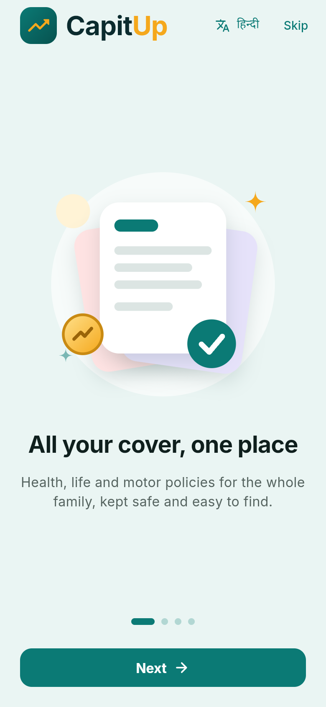 | 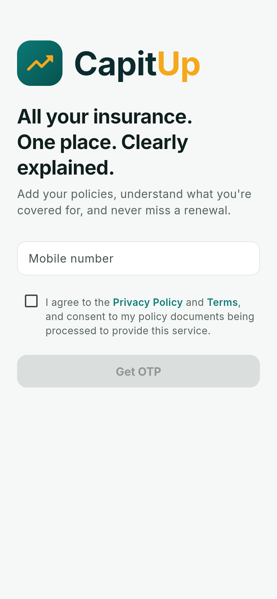 | 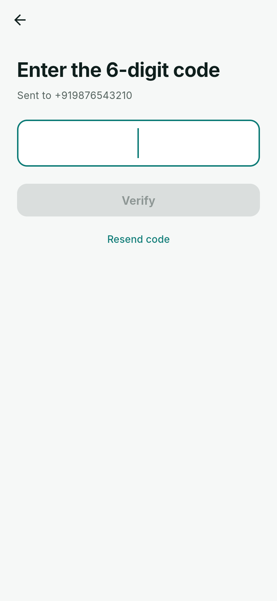 |

### Main screens

| Home | Home (scrolled) | Portfolio |
|---|---|---|
| 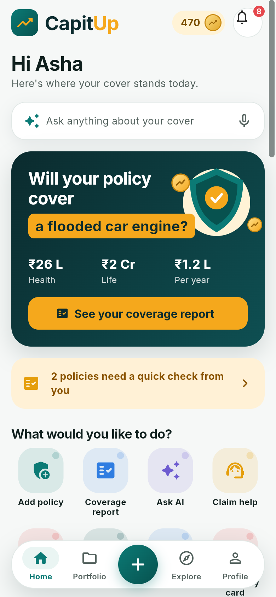 | 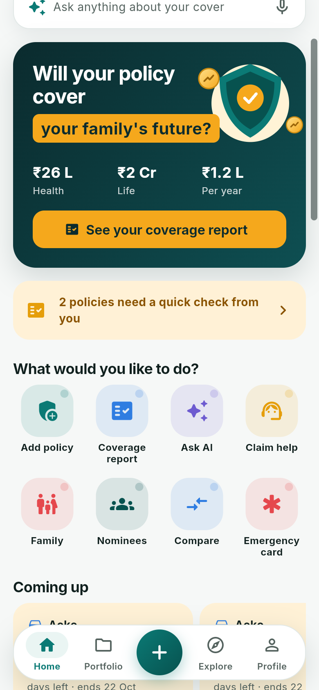 | 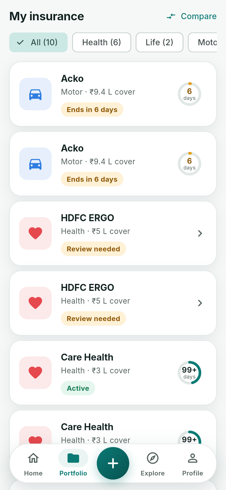 |

| Policy details | Coverage report | Ask AI |
|---|---|---|
| 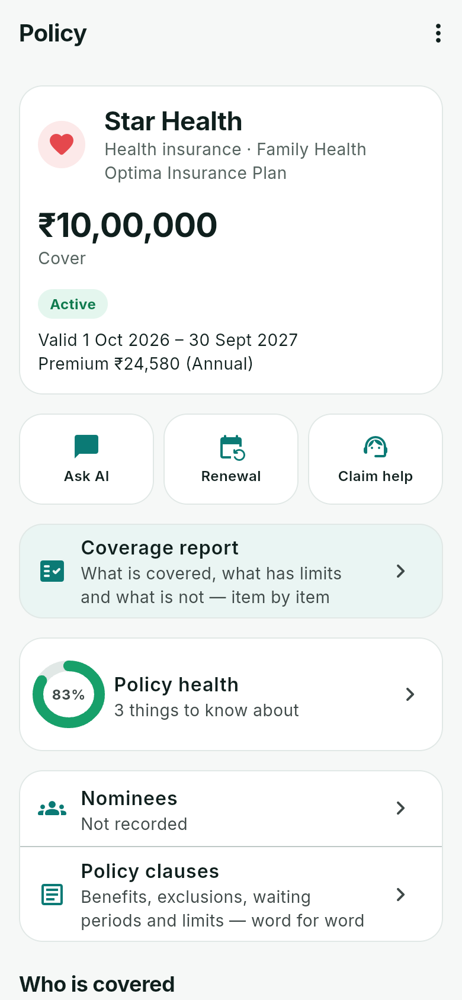 | 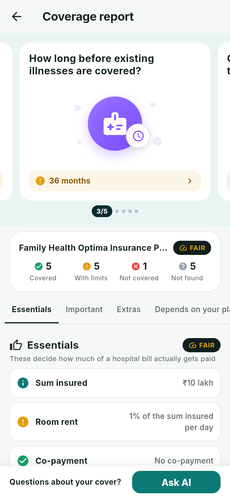 | 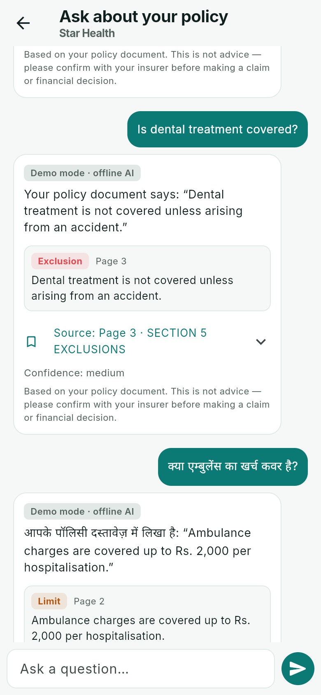 |

| Check your policy details | Nominees | Add a policy |
|---|---|---|
| 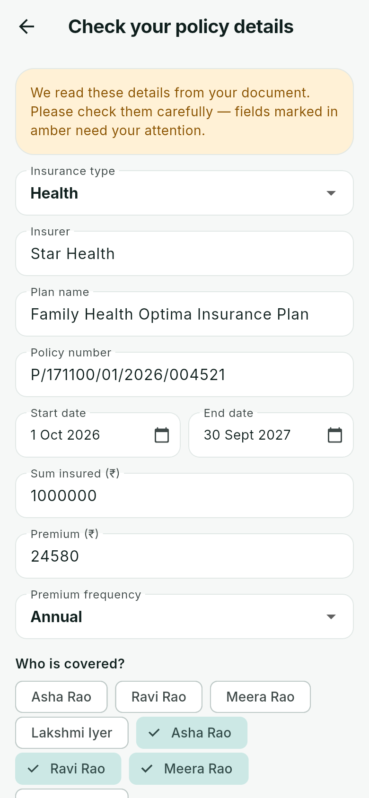 | 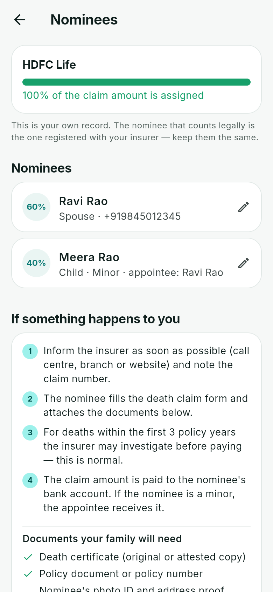 | 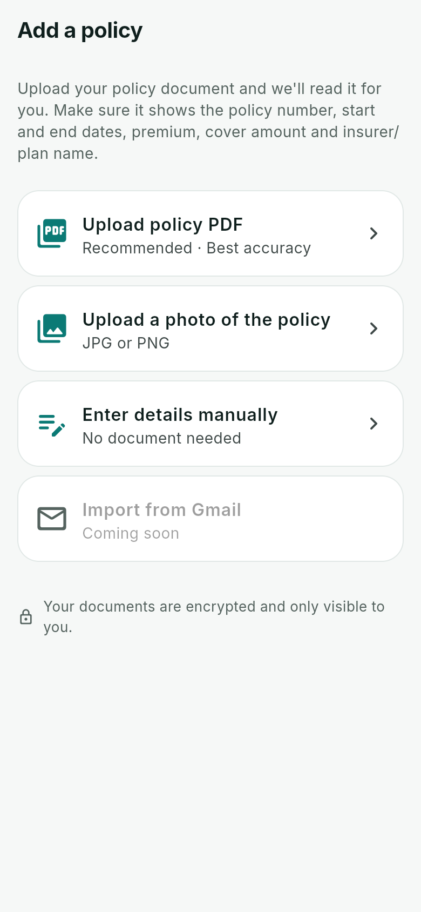 |

| Emergency card | Explore | Profile |
|---|---|---|
| 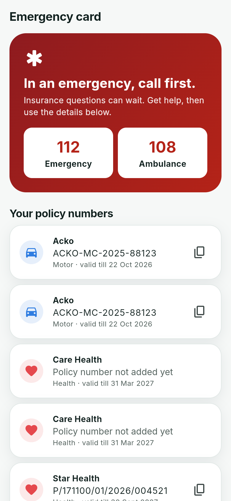 | 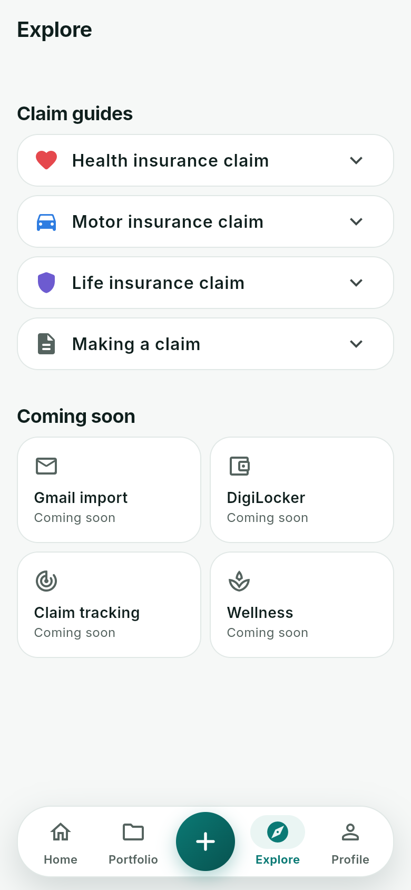 | 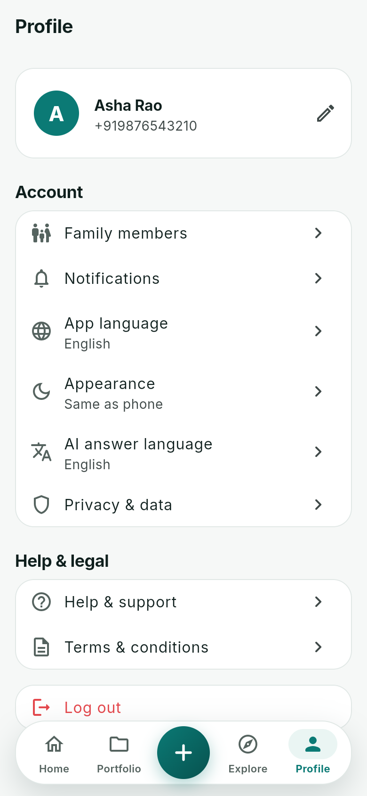 |

### Hindi (Profile → App language → हिन्दी)

| Home | Policy details | Profile |
|---|---|---|
| 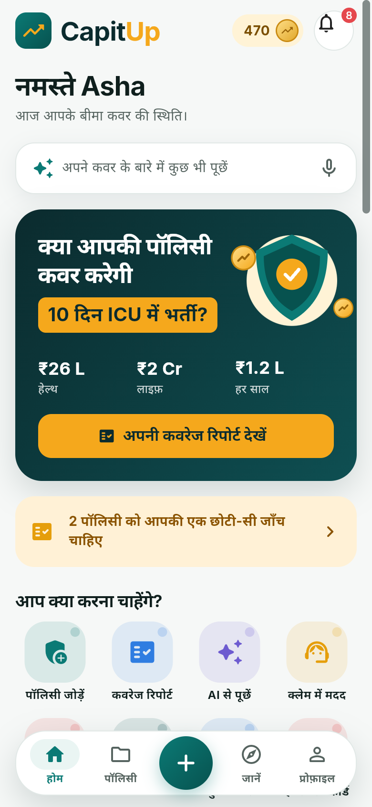 | 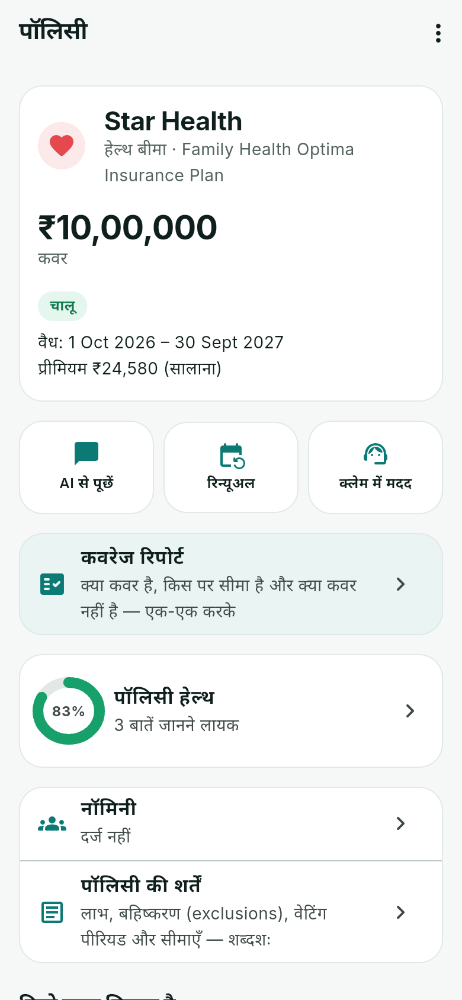 | 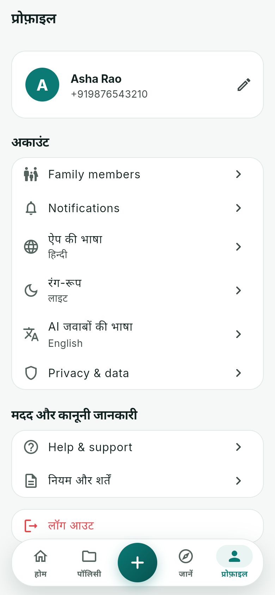 |

### Dark mode (Profile → Appearance → Dark)

| Home | Policy details | Coverage report | Profile |
|---|---|---|---|
| 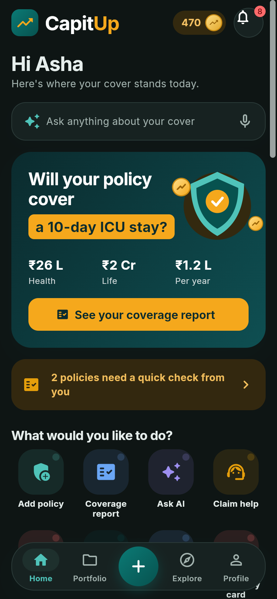 | 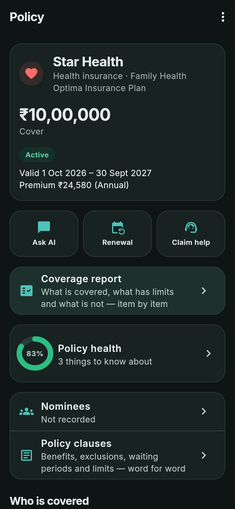 | 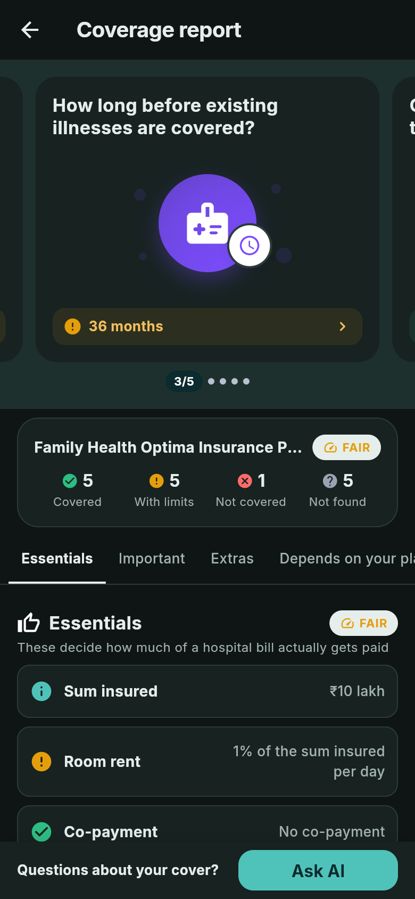 | 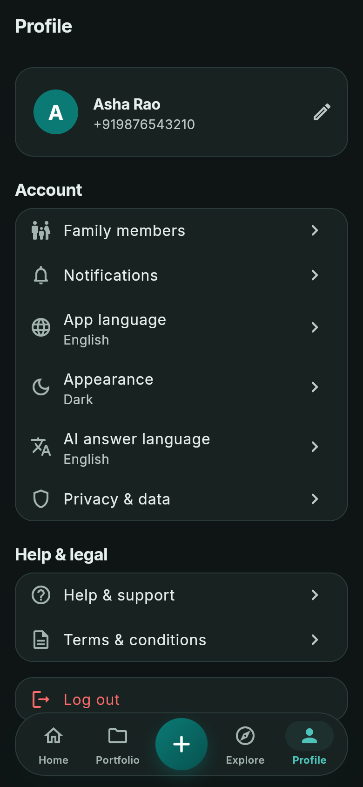 |

"Demo mode · offline AI" on the Ask AI answers is expected: in development the AI is a mock that quotes the sample PDF.

## 8. Check your setup (do this once)

```powershell
cd C:\dev\App-claude\mobile
dart format --output=none --set-exit-if-changed lib test   # no files listed = formatted
flutter analyze                                            # must say: No issues found!
flutter test                                               # must end: All tests passed! (~600)

cd ..\backend
.venv\Scripts\activate
pytest -q                                                  # all passed (105)
```

If all four pass and the app runs on the phone, your setup is done.

## 9. Daily workflow

```powershell
git checkout develop
git pull
git checkout -b feature/short-name      # one branch per task
# … make the change, run it on the phone, add a test …
dart format lib test
flutter analyze
flutter test
git add -A
git commit -m "Short description of what changed and why"
git push -u origin feature/short-name   # then open a pull request into develop on GitHub
```

Rules that keep the app working:

- **Text:** never type English text into a screen. Add a key to `mobile/lib/l10n/app_en.arb` and `app_hi.arb`, run
  `flutter gen-l10n`, then use `context.l10n.yourKey`.
- **Colours:** never use a hex colour in a screen; use `AppColors.<name>` (from `mobile/lib/app/theme/app_colors.dart`)
  so dark mode keeps working.
- **Tap targets:** buttons and tappable rows are at least 48 dp; the accessibility tests fail otherwise.
- **Check on the phone** in English and Hindi, light and dark, before opening a pull request.
- **CI** (GitHub → Actions) must be green on your pull request, including the Android APK build.

## 10. Secrets and data (no exceptions)

- Never commit or share: `backend/.env`, `mobile/android/key.properties`, `*.jks` signing keys, API keys, passwords.
  `.gitignore` blocks the usual ones; still check `git status` before committing.
- Never paste a key into chat, a screenshot or an issue. A key that leaks must be deleted and replaced.
- Use the offline mock AI and the demo PDFs. Never upload a real customer's policy to a development machine.
- Do not change Gradle, Kotlin, Java or Flutter versions to make an error go away; check `TROUBLESHOOTING.md`, then ask.

## 11. When something goes wrong

| You see | Do this |
|---|---|
| `No supported devices found` | `adb devices`; reconnect the phone, accept "Allow USB debugging" |
| Login says "connection timed out" | Backend window still running? `adb reverse tcp:8000 tcp:8000` again; `http://127.0.0.1:8000/health/ready` |
| `"database": "unreachable"` | Start Docker Desktop, then `docker compose up -d` |
| "This build uses a Java 8 JVM" | `flutter config --jdk-dir=<JDK 21 folder>`, then `cd mobile\android; .\gradlew.bat --stop` |
| "Dart SDK is not configured" in Android Studio | Settings → Languages & Frameworks → Dart → SDK path `C:\dev\flutter\bin\cache\dart-sdk` |
| Anything else during a build | [`TROUBLESHOOTING.md`](TROUBLESHOOTING.md), then ask with the full error text |

## 12. Read next

1. [`README.md`](../README.md): every feature and its status.
2. [`01-technical-blueprint.md`](01-technical-blueprint.md): architecture, data model, API design.
3. [`04-vision-plan.md`](04-vision-plan.md): where the product is going.
4. [`BRANCHES.md`](BRANCHES.md) and [`DEMO.md`](DEMO.md).
